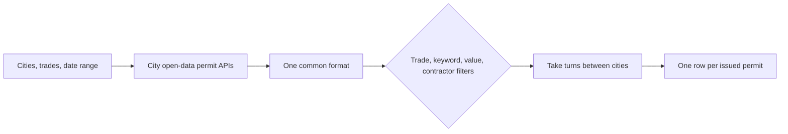

# Building Permit Leads: Contractors and Projects

[](https://apify.com/Turboextract/building-permit-leads)
[](LICENSE)
[](#pricing)

**Get newly issued building permits from Chicago, New York City, Los Angeles, San Francisco, Seattle and Austin in one feed.** Filter by trade like roofing, solar, HVAC or new construction, and get the work description, declared project value, address and, where the city publishes it, the contractor's name, license and phone.

A permit is the earliest public sign that money is about to be spent on a building. Suppliers, subcontractors and service companies that see it first win the work.

**Try it now →** [apify.com/Turboextract/building-permit-leads](https://apify.com/Turboextract/building-permit-leads)

---

## Why this exists

- A permit is the earliest public sign that money is about to be spent on a building.
- Every city publishes permits in its own format and portal.
- Contractor names and phones are in the data for some cities, but hard to filter by trade.
- Construction lead services charge monthly per market.

---

## Who this is for

- **Roofing, solar, HVAC, plumbing and electrical companies** finding jobs and competitor activity
- **Building material suppliers and equipment rental** firms selling to active contractors
- **Subcontractors** looking for general contractors with new projects
- **Home services, security and insurance** companies reaching owners after major work
- **Real estate investors and analysts** tracking renovation and development by area

---

## What you get per permit

```json
{
  "city": "New York City, NY",
  "issuedDate": "2026-11-13",
  "permitNumber": "B01482916-I1-SL",
  "permitType": "Solar",
  "workType": "Initial Permit",
  "description": "FILING HEREWITH TAX ABATEMENT APPLICATION FOR INSTALLATION OF ROOF MOUNTED SOLAR PANELS. NO CHANGE IN USE, EGRESS OR OCCUPANCY.",
  "value": 42750,
  "status": "Permit Issued",
  "address": { "street": "755 EAST 45 STREET (Brooklyn)", "zip": "11203" },
  "contractor": {
    "company": "SUNRUN INSTALLATION SVC",
    "name": "P. J.",
    "trade": "GC",
    "license": "613329"
  },
  "lat": 40.642843,
  "lon": -73.934264
}
```

---

## What each city publishes

| City | Contractor | Value | Notes |
|---|---|---|---|
| Austin, TX | Company, name, **phone**, trade | Yes | Richest contractor data |
| New York City, NY | Company, name, license | Yes | Owner name too |
| Chicago, IL | Listed contacts by role | Yes | Owner, contractors, applicant |
| Seattle, WA | Company, when listed | Yes | Link to the city record |
| San Francisco, CA | – | Yes | Link to the city record |
| Los Angeles, CA | – | Yes | The city refreshes its data weekly |

---

## How it works



All six cities publish permits through official open-data APIs. No scraping, no logins.

---

## Quick start

1. Click **Try for free**.
2. Keep all cities and **Issued in the last N days** at `7`.
3. Pick **Trades** like `roofing` or `solar`, or add **Keywords** like `restaurant`.
4. Optional: set **Min project value** or tick **Only permits with a contractor**.
5. Click **Start**, then schedule it weekly.

### API

```bash
curl -X POST "https://api.apify.com/v2/acts/Turboextract~building-permit-leads/run-sync-get-dataset-items?token=YOUR_TOKEN" \
  -H "Content-Type: application/json" \
  -d '{
    "cities": ["austin", "nyc"],
    "trades": ["solar", "electrical"],
    "requireContractor": true,
    "maxResults": 500
  }'
```

### Python

```python
from apify_client import ApifyClient

client = ApifyClient("YOUR_TOKEN")
run = client.actor("Turboextract/building-permit-leads").call(run_input={
    "cities": ["chicago", "seattle"],
    "trades": ["new_construction"],
    "minValue": 250000,
    "daysBack": 30,
})
for p in client.dataset(run["defaultDatasetId"]).iterate_items():
    print(p["city"], p["value"], p["address"]["street"], (p["contractor"] or {}).get("company"))
```

---

## Input fields

| Field | Default | What it does |
|---|---|---|
| `cities` | all 6 | chicago, nyc, la, sf, seattle, austin |
| `daysBack` | 7 | Issued in the last N days |
| `dateFrom` / `dateTo` | – | Exact date range |
| `trades` | – | roofing, solar, hvac, electrical, plumbing, pool, demolition, new_construction, addition, remodel, fence, signage |
| `keywords` | – | Description contains any word |
| `minValue` | 0 | Minimum declared project value |
| `requireContractor` | false | Only rows with a contractor |
| `maxResults` | 500 | Cap per run, shared between cities |

---

## Pricing

**$0.003 per permit delivered.** A week of solar permits across six cities costs a few cents.

| Option | 1,000 permits |
|---|---|
| **Building Permit Leads** | **$3**, six cities, trade filters, contractor details |
| Other permit actors on Apify | $1.90 to $30 |
| Construction lead services | Monthly subscriptions |
| Checking six city portals by hand | Hours every week |

---

## Common use cases

- **Solar and battery installers**: every new solar permit and the installer who pulled it
- **Roofers**: re-roof permits by neighborhood, and which competitors are busiest
- **Suppliers**: contractors with $250k+ new construction permits this month
- **Subcontractors**: general contractors starting large remodels
- **Competitor tracking**: which installers pull the most solar or roofing permits in your city

---

## Tips for best results

- Pick one or two `trades` instead of keywords for cleaner results.
- Use `requireContractor` with Austin and New York to see who is winning the work.
- Set `minValue` to skip small repair permits.
- Los Angeles refreshes weekly, so use `daysBack: 14` if you need it.

---

## Pairs well with

- [Local Business Leads with Emails](https://apify.com/Turboextract/osm-local-business-leads): contractor emails from their websites
- [New Business Registrations](https://apify.com/Turboextract/new-business-registrations): new construction LLCs from state registries
- [Federal Contract Winner Leads](https://apify.com/Turboextract/federal-contract-winners): federal construction awards

---

## FAQ

**Why did Los Angeles return nothing?** Los Angeles refreshes its permit data about once a week. The log tells you the latest date it has, so widen the date range to include it.

**How are trades matched?** On the permit description, type and contractor trade. A permit can match more than one trade.

**Why is the contractor empty for some cities?** San Francisco and Los Angeles do not publish contractors in their open data.

**Is this legal to use?** Yes. Building permits are public records published by each city for reuse.

---

## SEO keywords

building permits API, building permit leads, contractor leads, roofing permit data, solar permit leads, construction leads by city, new construction permits, HVAC permit leads, permit data scraper, city open data permits

---

## Support

- Actor page: https://apify.com/Turboextract/building-permit-leads
- Issues and questions: open an issue in this repo
- Community Discord: https://discord.gg/8SrXSCpvgj

Built and maintained by [Turboextract](https://apify.com/Turboextract) on the Apify platform.

---

## License

The documentation and examples in this repository are MIT licensed. The actor itself runs on the Apify platform.
